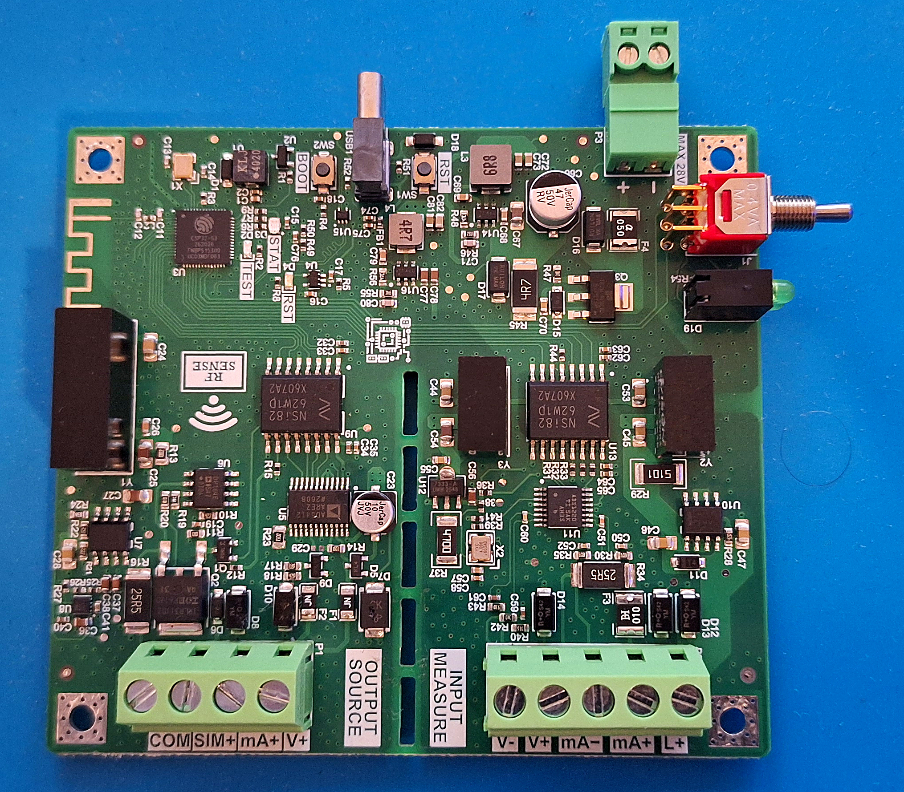
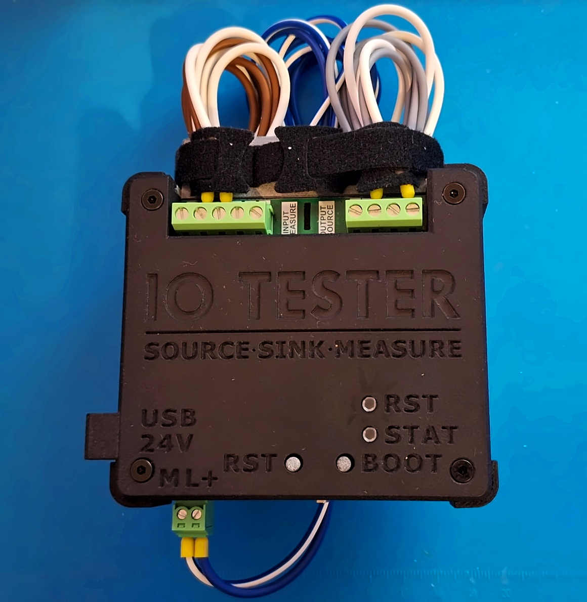
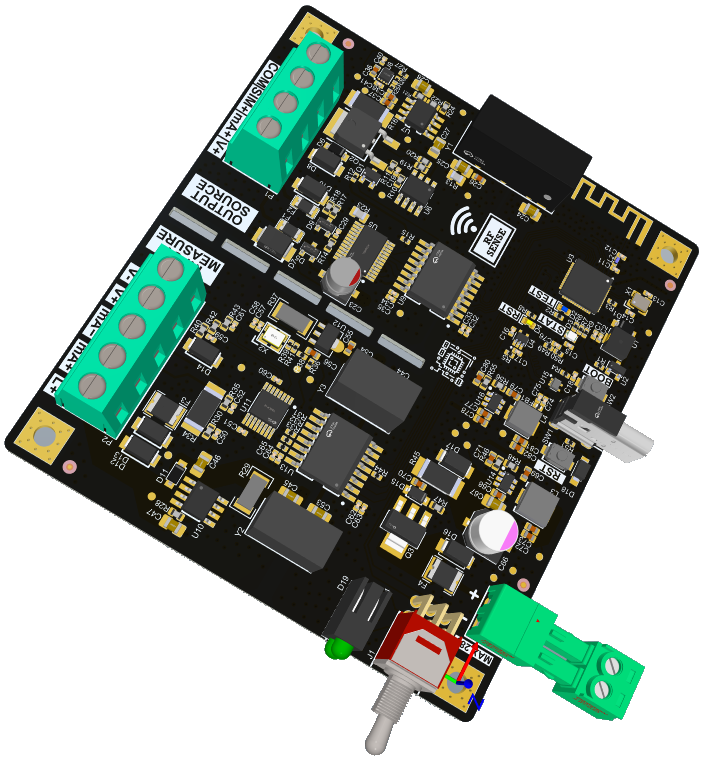
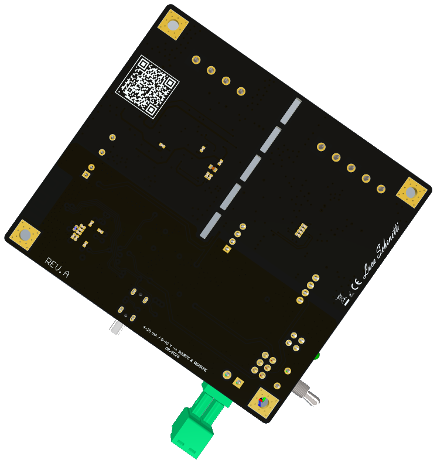

# IO TESTER — Source · Sink · Measure

<p align="center"></p>

**🇬🇧 [English](#-english) · 🇮🇹 [Italiano](#-italiano)**

# 🇬🇧 English

**Open-hardware, galvanically isolated, portable calibrator for PLC analog I/O, based on the ESP32-S3**

IO TESTER is a pocket-size field tool for commissioning and troubleshooting PLC analog I/O cards. It was designed around Siemens SM 331 / ET 200SP 6ES7135-class modules, but works with any 0–10 V / 4–20 mA system.
It **generates**, **sinks** and **measures** standard process signals, and you control it from your smartphone over Wi-Fi: no laptop and no software to install.

> *PLC reading a strange value?* Connect IO TESTER, inject a known signal and read what comes back. Within a minute you know whether the problem is the field device, the wiring or the card.

---

## ✨ Features

| Mode | What it does |
|---|---|
| **SOURCE** | Generates 0–10 V, 4–20 mA and 0–20 mA to test PLC analog **inputs** (AD5412, 12 bit) |
| **SINK** | Simulates a passive **2-wire transmitter** (4–20 mA) powered by the PLC loop |
| **MEASURE** | Reads 0–10 V and 4–20 mA from PLC analog **outputs** or from transmitters, either 4-wire (active source) or 2-wire powered by the tester's own **L+ ≈ 24 V** (ADS1220, 24 bit ΔΣ, 50/60 Hz rejection) |
| **Process Simulator** | Hardware-in-the-loop virtual plant for tuning the PLC PID (e.g. PID_Compact) without the real process |
| **Guided Tests** | Step tests for converters/isolators and valves/positioners (step test, dead band, tolerance) |
| **Scale, Alarm, Record** | Engineering units, high/low thresholds with alarm, min/max |
| **Calibration** | Calibration of 5 channels stored in NVS; outputs are calibrated automatically in loopback |

- 📱 Web interface served by the ESP32-S3 (Wi-Fi access point + captive portal), in Italian and English, with light and dark themes and a layout designed for phones. An Android app is optional.
- 🔒 **Three galvanically isolated domains** (system / input / output), so the PLC, the field and the tester share no common ground.
- 🔋 Powered from a **USB-C power bank (5 V)** or from the **24 V field supply**, selected with a 3-position switch.
- 🛡️ Field terminals are protected by bidirectional TVS diodes, resettable PPTC fuses and clamp diodes. The 24 V input has reverse-polarity protection and a two-stage clamp.
- 🔁 Firmware and web interface can be updated from the browser (PIN protected) or over the air (OTA).
- 🧲 Rugged MJF-printed enclosure with brass inserts, a magnetic base, light pipes and replaceable corner bumpers.

## 📸 Example application

<p align="center"></p>

IO TESTER in its MJF-printed enclosure, wired and ready for use in the field.

## 📋 Specifications

| | |
|---|---|
| MCU | ESP32-S3FN8 (8 MB flash, no PSRAM), Wi-Fi access point |
| Voltage output | 0–10 V, minimum load 1 kΩ |
| Current output | 4–20 mA / 0–20 mA, compliance ≈ AVDD − 2.5 V (≈ 950 Ω at 20 mA) |
| DAC | AD5412, 12 bit, internal 5 V reference, external R<sub>SET</sub> 15 kΩ 0.1 % |
| Current sink | 4–20 mA, 2-wire, loop powered by the PLC (OP184 + MOSFET, 25.5 Ω shunt) |
| Voltage input | 0–10 V (full scale ≈ 20.6 V), divider 90.9 kΩ / 10 kΩ 0.05 % |
| Current input | 4–20 mA, 4-wire or 2-wire, shunt 25.5 Ω 0.05 % (full scale ≈ 40 mA) |
| Loop supply L+ | ≈ 24 V isolated, current limited (LM317L), for 2-wire transmitters |
| ADC | ADS1220, 24 bit ΔΣ, 20 SPS, 4.096 MHz oscillator for 50/60 Hz rejection |
| Accuracy target | ±0.3 % (see [Test status](#-test-status)) |
| Isolation | 3 domains: isolated DC-DC (B0524S / B0505S) + NSI8262W1 digital isolators |
| Power | USB-C 5 V (power bank ≥ 2 A) or 24 V field supply (max 28 V on P3, AP63301 buck) |
| Consumption at 5 V | ≈ 250 mA idle, ≈ 375 mA with a 20 mA output (measured) |
| PCB | 4 layers, 90 × 80.5 mm, ready for JLCPCB assembly (BOM with LCSC codes + CPL) |
| Enclosure | 95.8 × 86.3 × 23.6 mm |

## 🧩 Hardware architecture

| PCB 3D – top | PCB 3D – bottom |
|:---:|:---:|
|  |  |


```
                 ┌──────────── SYSTEM DOMAIN (+5 V SYS, not isolated) ────────────┐
 USB-C 5 V ──┐   │                                                                 │
             ├─ SW 3-pos ── +5 V SYS ── LDO 3.3 V ── ESP32-S3 (Wi-Fi, web UI)      │
 24 V field ─┘   │   ▲ TVS 2-stage, PPTC, P-MOS reverse protection, AP63301 buck   │
                 └──────┬──────────────────────────────────────────┬──────────────┘
                        │ isolated DC-DC + NSI8262W1               │ isolated DC-DC + NSI8262W1
          ┌─────────────▼─────────────┐              ┌─────────────▼─────────────┐
          │  INPUT DOMAIN (isolated)  │              │ OUTPUT DOMAIN (isolated)  │
          │  ADS1220 24 bit           │              │ AD5412 12 bit (V / mA)    │
          │  25.5 Ω 0.05 % shunt      │              │ −4 V rail (LM27761)       │
          │  0–10 V divider           │              │ 2-wire sink (OP184+MOSFET)│
          │  L+ ≈ 24 V loop supply    │              │ sink interlock            │
          └───────────────────────────┘              └───────────────────────────┘
               P2 INPUT / MEASURE                         P1 OUTPUT / SOURCE
```

### Terminals

| P1 OUTPUT (Source / Sink) | | P2 INPUT (Measure) | |
|---|---|---|---|
| P1.1 | COM | P2.1 | V− |
| P1.2 | SIM+ (2-wire sink) | P2.2 | V+ |
| P1.3 | mA+ | P2.3 | mA− |
| P1.4 | V+ | P2.4 | mA+ |
| | | P2.5 | L+ (loop supply) |

P3 is the 24 V field supply input (max 28 V).

- **2-wire transmitter powered by IO TESTER:** transmitter + → L+ (P2.5), transmitter − → mA+ (P2.4)
- **4-wire transmitter / active source:** + → mA+ (P2.4), − → mA− (P2.3)

## 📁 Repository structure

| Folder | Contents |
|---|---|
| [`1-Draw`](1-Draw) | Altium Designer project (schematics, PCB, Draftsman, OutJob) and [`Schematic PDF.pdf`](1-Draw/Schematic%20PDF.pdf) |
| [`3-Gerber File & BOM`](3-Gerber%20File%20%26%20BOM) | Gerber files (Rev B), BOM with LCSC codes and CPL for JLCPCB |
| [`5-Spec`](5-Spec) | Datasheets of the main components |
| [`6-Firmware`](6-Firmware) | PlatformIO firmware (`src`, `include`), web interface (`data`), Android app (`android`), binaries (`release`), tools (`tools`) |
| [`7-Test Report`](7-Test%20Report) | Rev B test report (Italian), with all measurements |
| [`8-Photo`](8-Photo) | Photos and 3D renders |
| [`10-3D Case`](10-3D%20Case) | Enclosure: `STEP FILE` and `STL FILE` |

## 🔧 Getting started

### 1. Build the board
Upload the contents of `3-Gerber File & BOM` (Gerber, BOM, CPL) to JLCPCB to order the PCB with assembly. Every part has an LCSC code in the BOM.

### 2. Print the enclosure

| File | Qty | JLC3DP (recommended) | Home printing (FDM) |
|---|---|---|---|
| `LID` | 1 | MJF PA12S-HP, black | PETG |
| `BASE` | 1 | MJF PA12S-HP, grey (natural) | PETG |
| `CORNER_BUMPER` | 4 | MJF PA11-HP, black | TPU 95A, rounded end on the bed, no supports |
| `BUTTONS_RST-BOOT` | 2 | MJF PA12S-HP, black | PETG, head on the bed, no supports |
| `LIGHTPIPE_STAT` + `LIGHTPIPE_RST` (STL)<br>`LIGHTPIPE_STAT_RST` (STEP) | 1 each | Clear SLA resin | PETG for testing only: print lying on its side, 100 % infill, fan off. Alternative: Ø 2 mm clear acrylic rod |

Order **either** the STEP files **or** the STL files from JLC3DP, not both.

**Hardware:**
- 4× M3 × 22 countersunk hex socket screw (ISO 10642), black
- 4× M3 knurled heat-set insert, Ø 5 mm, L 6 mm
- 4× N52 neodymium magnet, Ø 10 × 3 mm, glued into the bottom seats
- 2× foam ring, 1 mm thick, OD 6 mm, ID 3.8 mm (one per button, prevents rattling)
- Clear UV glue for the light pipes (avoid cyanoacrylate near clear resin: its fumes turn it white)

**Assembly:**
1. Press the inserts into the 4 posts of the base with a soldering iron.
2. Glue the magnets into the bottom, all with the same polarity facing out.
3. Insert the light pipes into the lid from the top and fix them with a tiny drop of UV glue. Then fit the foam rings onto the buttons and insert the buttons from inside the lid.
4. Slide the corner bumpers into the dovetail grooves of the base. A drop of glue is optional.
5. Place the PCB on the posts, close the lid and tighten the 4 screws.

### 3. Firmware and web interface

**Ready-made binaries.** [`6-Firmware/release`](6-Firmware/release) contains the firmware, the web interface and the Android app (APK). Open the *Info App* page in the browser and load `IOTester-fw-x.y.z.bin` first, then `IOTester-ui-x.y.z.bin`. The service PIN is required.

**Build from source.** You need [PlatformIO](https://platformio.org/):
```bash
cd 6-Firmware
pio run -e esp32-s3fn8 -t upload      # firmware over USB
pio run -e esp32-s3fn8 -t uploadfs    # web interface (LittleFS)
```

### 4. Connect
Connect your phone to the Wi-Fi network **IO-Tester**. The captive portal opens the interface automatically, or you can browse to `http://192.168.4.1`. For safety, the outputs switch off if no client has been connected for 2 s.

The Android app in `6-Firmware/android` is a minimal WebView that connects to the tester's Wi-Fi on its own (Android 7.0+, automatic connection from Android 10).

> ⚠️ **Security: change the default credentials before using the tester on a real plant.** They are:
> - the Wi-Fi password: `AP_PASS` in `6-Firmware/src/web_server.cpp`
> - the OTA password: `[ota]` in `6-Firmware/platformio.ini`
> - the service PIN `1234`: change it from the web interface
>
> Anyone who knows them and is within Wi-Fi range could drive the outputs connected to your PLC.

## ✅ Test status

PCB **Rev B** has been built and tested. The full report is in Italian: [`7-Test Report/TEST-REPORT.md`](7-Test%20Report/TEST-REPORT.md).

- ✅ Passed: 24 V input and reverse polarity, SPI, isolators, Wi-Fi, AD5412 outputs, ADS1220 inputs, sink and interlock, protections, power consumption.
- ✅ After calibration the 2-wire sink is within **±0.21 %** of span (target ±0.3 %).
- ⏳ Not yet done: 500 V isolation test, metrological verification with a ≥ 5½-digit meter, test on a real PLC.

### Key measurements (Rev B)

| Test | Result |
|---|---|
| Voltage output ↔ ADS1220 input, 0–10 V loopback | agreement within **±2 mV (±0.02 %)**, noise 0.2 mV p-p |
| Current output ↔ ADS1220 input, 4–20 mA loopback | gain error **−0.11 %**, noise 0.4 µA p-p |
| Voltage output with 1 kΩ load | **−0.8 %**, caused by the PPTC fuse F1 (≈ 7.9 Ω) outside the sense loop: known Rev B limit |
| 2-wire sink, uncalibrated | up to **+0.70 %** of span |
| 2-wire sink, calibrated, at 4 / 12 / 20 mA | **−0.18 % / +0.14 % / −0.21 %** of span |
| Output domain supply AVDD | 23.5 V |
| Loop supply L+: no load / short-circuit current | 23.9 V / 26.6 mA |
| Consumption at 5 V: idle / 20 mA output / realistic maximum | 253 mA / 375 mA / 470 mA |
| Voltage output short-circuited | 16.6 mA, no overheating, output recovers to 9.98 V |
| 24 V with reverse polarity on the power input and on the sink | blocked, 0 mA |

The loopback tests compare the board's DAC and ADC with each other; absolute accuracy still has to be verified with a reference meter.

## ⚠️ Disclaimer

IO TESTER is a personal engineering project, **not a certified measuring instrument**. Its isolation has not yet been tested at 500 V, so do not rely on it for safety. Use it at your own risk and always follow the safety rules of the plant you are working on.

## 📄 License

This project is released under the **CERN Open Hardware Licence Version 2 – Strongly Reciprocal** ([CERN-OHL-S-2.0](LICENSE)).

© 2026 Luca Schenetti

<br>

---

# 🇮🇹 Italiano

**Calibratore portatile open hardware, con isolamento galvanico, per gli I/O analogici dei PLC, basato su ESP32-S3**

IO TESTER è uno strumento da campo tascabile per la messa in servizio e la ricerca guasti sulle schede di I/O analogici dei PLC. È stato progettato attorno ai moduli Siemens SM 331 / ET 200SP della famiglia 6ES7135, ma funziona con qualsiasi sistema 0–10 V / 4–20 mA.
**Genera**, **assorbe** e **misura** i segnali di processo standard e si comanda dallo smartphone via Wi-Fi: niente PC e niente software da installare.

> *Il PLC legge un valore strano?* Collega IO TESTER, inietta un segnale noto e leggi cosa torna indietro. In un minuto sai se il problema è nello strumento di campo, nel cablaggio o nella scheda.

---

## ✨ Funzioni

| Modo | Cosa fa |
|---|---|
| **SOURCE** | Genera 0–10 V, 4–20 mA e 0–20 mA per provare gli **ingressi** analogici del PLC (AD5412, 12 bit) |
| **SINK** | Simula un **trasmettitore passivo a 2 fili** (4–20 mA) alimentato dall'anello del PLC |
| **MEASURE** | Legge 0–10 V e 4–20 mA dalle **uscite** analogiche del PLC o dai trasmettitori, sia a 4 fili (sorgente attiva) sia a 2 fili alimentati dall'**L+ ≈ 24 V** dello strumento (ADS1220, 24 bit ΔΣ, reiezione 50/60 Hz) |
| **Simulatore di Processo** | Impianto virtuale in hardware-in-the-loop per tarare il PID del PLC (es. PID_Compact) senza il processo reale |
| **Prove Guidate** | Prove a gradino per convertitori/isolatori e valvole/posizionatori (gradino, banda morta, tolleranza) |
| **Scalatura, Soglie, Registrazione** | Unità ingegneristiche, soglie alta/bassa con allarme, minimo/massimo |
| **Calibrazione** | Calibrazione di 5 canali salvata in NVS; le uscite si calibrano da sole in loopback |

- 📱 Interfaccia web servita dall'ESP32-S3 (access point Wi-Fi + captive portal), in italiano e inglese, con tema chiaro e scuro, pensata per il telefono. L'app Android è opzionale.
- 🔒 **Tre domini con isolamento galvanico** (sistema / ingresso / uscita): PLC, campo e strumento non hanno masse in comune.
- 🔋 Alimentazione da **powerbank USB-C (5 V)** oppure dai **24 V di campo**, scelta con un commutatore a 3 posizioni.
- 🛡️ Morsetti di campo protetti da TVS bidirezionali, fusibili ripristinabili PPTC e diodi di clamp. L'ingresso 24 V ha la protezione contro l'inversione di polarità e un clamp a due stadi.
- 🔁 Firmware e interfaccia web si aggiornano dal browser (con PIN) oppure via OTA.
- 🧲 Case robusto stampato in MJF, con inserti in ottone, base magnetica, light pipe e paraspigoli sostituibili.

## 📸 Esempio di applicazione

<p align="center"></p>

IO TESTER nel suo case stampato in MJF, cablato e pronto per l'uso sul campo.

## 📋 Caratteristiche

| | |
|---|---|
| MCU | ESP32-S3FN8 (8 MB flash, senza PSRAM), access point Wi-Fi |
| Uscita tensione | 0–10 V, carico minimo 1 kΩ |
| Uscita corrente | 4–20 mA / 0–20 mA, compliance ≈ AVDD − 2,5 V (≈ 950 Ω a 20 mA) |
| DAC | AD5412, 12 bit, riferimento interno 5 V, R<sub>SET</sub> esterna 15 kΩ 0,1 % |
| Sink di corrente | 4–20 mA, 2 fili, anello alimentato dal PLC (OP184 + MOSFET, shunt 25,5 Ω) |
| Ingresso tensione | 0–10 V (fondo scala ≈ 20,6 V), partitore 90,9 kΩ / 10 kΩ 0,05 % |
| Ingresso corrente | 4–20 mA, 4 fili o 2 fili, shunt 25,5 Ω 0,05 % (fondo scala ≈ 40 mA) |
| Alimentazione d'anello L+ | ≈ 24 V isolati, con limitazione di corrente (LM317L), per i trasmettitori a 2 fili |
| ADC | ADS1220, 24 bit ΔΣ, 20 SPS, oscillatore 4,096 MHz per la reiezione 50/60 Hz |
| Accuratezza obiettivo | ±0,3 % (vedi [Stato del collaudo](#-stato-del-collaudo)) |
| Isolamento | 3 domini: DC-DC isolati (B0524S / B0505S) + isolatori digitali NSI8262W1 |
| Alimentazione | USB-C 5 V (powerbank ≥ 2 A) oppure 24 V di campo (max 28 V su P3, buck AP63301) |
| Consumo a 5 V | ≈ 250 mA a riposo, ≈ 375 mA con l'uscita a 20 mA (misurati) |
| PCB | 4 strati, 90 × 80,5 mm, pronta per il montaggio JLCPCB (BOM con codici LCSC + CPL) |
| Case | 95,8 × 86,3 × 23,6 mm |

## 🧩 Architettura hardware

| PCB 3D – lato superiore | PCB 3D – lato inferiore |
|:---:|:---:|
|  |  |


```
                 ┌──────────── DOMINIO SISTEMA (+5 V SYS, non isolato) ────────────┐
 USB-C 5 V ──┐   │                                                                 │
             ├─ SW 3 pos ── +5 V SYS ── LDO 3,3 V ── ESP32-S3 (Wi-Fi, web)        │
 24 V campo ─┘   │   ▲ TVS 2 stadi, PPTC, P-MOS anti-inversione, buck AP63301      │
                 └──────┬──────────────────────────────────────────┬──────────────┘
                        │ DC-DC isolato + NSI8262W1                │ DC-DC isolato + NSI8262W1
          ┌─────────────▼─────────────┐              ┌─────────────▼─────────────┐
          │ DOMINIO INGRESSO (isolato)│              │ DOMINIO USCITA (isolato)  │
          │  ADS1220 24 bit           │              │ AD5412 12 bit (V / mA)    │
          │  shunt 25,5 Ω 0,05 %      │              │ rail −4 V (LM27761)       │
          │  partitore 0–10 V         │              │ sink 2 fili (OP184+MOSFET)│
          │  L+ ≈ 24 V d'anello       │              │ interblocco del sink      │
          └───────────────────────────┘              └───────────────────────────┘
               P2 INPUT / MEASURE                         P1 OUTPUT / SOURCE
```

### Morsetti

| P1 OUTPUT (Source / Sink) | | P2 INPUT (Measure) | |
|---|---|---|---|
| P1.1 | COM | P2.1 | V− |
| P1.2 | SIM+ (sink 2 fili) | P2.2 | V+ |
| P1.3 | mA+ | P2.3 | mA− |
| P1.4 | V+ | P2.4 | mA+ |
| | | P2.5 | L+ (alimentazione d'anello) |

P3 è l'ingresso dei 24 V di campo (max 28 V).

- **Trasmettitore a 2 fili alimentato da IO TESTER:** + trasmettitore → L+ (P2.5), − trasmettitore → mA+ (P2.4)
- **Trasmettitore a 4 fili / sorgente attiva:** + → mA+ (P2.4), − → mA− (P2.3)

## 📁 Struttura del repository

| Cartella | Contenuto |
|---|---|
| [`1-Draw`](1-Draw) | Progetto Altium Designer (schemi, PCB, Draftsman, OutJob) e [`Schematic PDF.pdf`](1-Draw/Schematic%20PDF.pdf) |
| [`3-Gerber File & BOM`](3-Gerber%20File%20%26%20BOM) | Gerber (rev. B), BOM con codici LCSC e CPL per JLCPCB |
| [`5-Spec`](5-Spec) | Datasheet dei componenti principali |
| [`6-Firmware`](6-Firmware) | Firmware PlatformIO (`src`, `include`), interfaccia web (`data`), app Android (`android`), file compilati (`release`), strumenti (`tools`) |
| [`7-Test Report`](7-Test%20Report) | Rapporto di collaudo della rev. B, con tutte le misure |
| [`8-Photo`](8-Photo) | Foto e render 3D |
| [`10-3D Case`](10-3D%20Case) | Case: `STEP FILE` e `STL FILE` |

## 🔧 Come iniziare

### 1. Produrre la scheda
Carica su JLCPCB il contenuto di `3-Gerber File & BOM` (Gerber, BOM, CPL) per ordinare la PCB montata. Ogni componente ha il codice LCSC nella BOM.

### 2. Stampare il case

| File | Q.tà | JLC3DP (consigliato) | Stampa in casa (FDM) |
|---|---|---|---|
| `LID` (coperchio) | 1 | MJF PA12S-HP, nero | PETG |
| `BASE` | 1 | MJF PA12S-HP, grigio (naturale) | PETG |
| `CORNER_BUMPER` (paraspigolo) | 4 | MJF PA11-HP, nero | TPU 95A, estremità arrotondata sul piatto, senza supporti |
| `BUTTONS_RST-BOOT` (pulsantini) | 2 | MJF PA12S-HP, nero | PETG, testa sul piatto, senza supporti |
| `LIGHTPIPE_STAT` + `LIGHTPIPE_RST` (STL)<br>`LIGHTPIPE_STAT_RST` (STEP) | 1 per tipo | Resina SLA trasparente | PETG solo per prova: sdraiati, riempimento 100 %, ventola spenta. In alternativa barretta di acrilico trasparente Ø 2 mm |

Su JLC3DP ordina **o** gli STEP **o** gli STL, non entrambi.

**Ferramenta:**
- 4 viti M3 × 22 svasate a esagono incassato (ISO 10642), nere
- 4 inserti filettati M3 zigrinati a caldo, Ø 5 mm, L 6 mm
- 4 magneti al neodimio N52, Ø 10 × 3 mm, incollati nelle sedi sul fondo
- 2 anellini di gommapiuma, spessore 1 mm, Ø esterno 6 mm, foro 3,8 mm (uno per pulsantino, contro il tintinnio)
- Colla UV trasparente per i light pipe (niente colla ciano vicino alla resina trasparente: i vapori la rendono opaca)

**Montaggio:**
1. Inserisci gli inserti a caldo nelle 4 colonnine della base.
2. Incolla i magneti nel fondo, tutti con la stessa polarità verso l'esterno.
3. Infila i light pipe nel coperchio dall'alto e bloccali con una goccia minima di colla UV. Poi metti gli anellini sui pulsantini e infila i pulsantini dall'interno del coperchio.
4. Fai scorrere i paraspigoli nelle scanalature a coda di rondine della base. Una goccia di colla è facoltativa.
5. Appoggia la PCB sulle colonnine, chiudi il coperchio e avvita le 4 viti.

### 3. Firmware e interfaccia web

**File già compilati.** In [`6-Firmware/release`](6-Firmware/release) ci sono il firmware, l'interfaccia web e l'app Android (APK). Apri la pagina *Info App* nel browser e carica prima `IOTester-fw-x.y.z.bin`, poi `IOTester-ui-x.y.z.bin`. Serve il PIN di servizio.

**Compilare dai sorgenti.** Serve [PlatformIO](https://platformio.org/):
```bash
cd 6-Firmware
pio run -e esp32-s3fn8 -t upload      # firmware via USB
pio run -e esp32-s3fn8 -t uploadfs    # interfaccia web (LittleFS)
```

### 4. Collegarsi
Collega il telefono alla rete Wi-Fi **IO-Tester**. Il captive portal apre l'interfaccia da solo, oppure vai su `http://192.168.4.1`. Per sicurezza le uscite si spengono se nessun client è collegato da 2 s.

L'app Android in `6-Firmware/android` è una WebView minimale che si collega da sola al Wi-Fi dello strumento (Android 7.0+, collegamento automatico da Android 10).

> ⚠️ **Sicurezza: cambia le credenziali predefinite prima di usare lo strumento su un impianto reale.** Sono:
> - la password del Wi-Fi: `AP_PASS` in `6-Firmware/src/web_server.cpp`
> - la password OTA: `[ota]` in `6-Firmware/platformio.ini`
> - il PIN di servizio `1234`: si cambia dall'interfaccia web
>
> Chi le conosce e si trova nel raggio del Wi-Fi potrebbe comandare le uscite collegate al tuo PLC.

## ✅ Stato del collaudo

La PCB **rev. B** è stata prodotta e collaudata. Il rapporto completo è in [`7-Test Report/TEST-REPORT.md`](7-Test%20Report/TEST-REPORT.md).

- ✅ Superati: ingresso 24 V e inversione di polarità, SPI, isolatori, Wi-Fi, uscite AD5412, ingressi ADS1220, sink e interblocco, protezioni, consumi.
- ✅ Dopo la calibrazione il sink a 2 fili sta entro **±0,21 %** del campo (obiettivo ±0,3 %).
- ⏳ Da fare: prova d'isolamento a 500 V, verifica metrologica con strumento ≥ 5½ cifre, prova su PLC reale.

### Misure principali (rev. B)

| Prova | Risultato |
|---|---|
| Uscita tensione ↔ ingresso ADS1220, loopback 0–10 V | accordo entro **±2 mV (±0,02 %)**, rumore 0,2 mV picco-picco |
| Uscita corrente ↔ ingresso ADS1220, loopback 4–20 mA | errore di guadagno **−0,11 %**, rumore 0,4 µA picco-picco |
| Uscita tensione con carico da 1 kΩ | **−0,8 %**, dovuto al fusibile PPTC F1 (≈ 7,9 Ω) fuori dall'anello di misura: limite noto della rev. B |
| Sink a 2 fili, senza calibrazione | fino a **+0,70 %** del campo |
| Sink a 2 fili, calibrato, a 4 / 12 / 20 mA | **−0,18 % / +0,14 % / −0,21 %** del campo |
| Alimentazione del dominio uscita AVDD | 23,5 V |
| Alimentazione d'anello L+: a vuoto / corrente di cortocircuito | 23,9 V / 26,6 mA |
| Consumo a 5 V: riposo / uscita a 20 mA / massimo realistico | 253 mA / 375 mA / 470 mA |
| Uscita tensione in cortocircuito | 16,6 mA, nessun surriscaldamento, l'uscita torna a 9,98 V |
| 24 V con polarità invertita sull'alimentazione e sul sink | bloccati, 0 mA |

Le prove in loopback confrontano fra loro il DAC e l'ADC della scheda; l'accuratezza assoluta va ancora verificata con uno strumento di riferimento.

## ⚠️ Avvertenze

IO TESTER è un progetto personale di ingegneria, **non uno strumento di misura certificato**. L'isolamento non è ancora stato provato a 500 V, quindi non affidarti a esso per la sicurezza. Usalo a tuo rischio e rispetta sempre le norme di sicurezza dell'impianto su cui lavori.

## 📄 Licenza

Il progetto è rilasciato con la **CERN Open Hardware Licence Version 2 – Strongly Reciprocal** ([CERN-OHL-S-2.0](LICENSE)).

© 2026 Luca Schenetti
